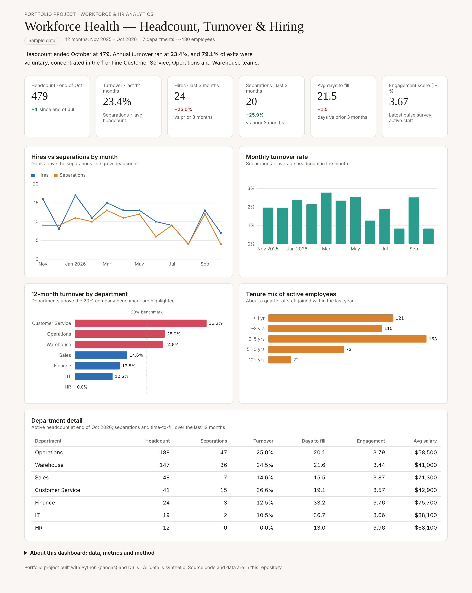

# Workforce Analytics Dashboard 👥

An end-to-end HR analytics project: synthetic employee records (hire and exit dates, department, pay, engagement) → monthly workforce snapshots in Python & SQL → an interactive D3.js dashboard tracking headcount, turnover, hiring speed and tenure.

**🔗 Live dashboard:** `https://<your-github-username>.github.io/workforce-analytics-dashboard/`



---

## Business question

> Where are we losing people, how fast are we replacing them, and which teams need retention attention?

## Key findings

| Metric | Value |
|---|---|
| Headcount (end of Oct 2026) | 479 (+4 since July) |
| 12-month turnover | 23.4% |
| Share of exits that were voluntary | 79.1% |
| Avg days to fill (Aug–Oct) | 21.5 days (+1.5 vs prior 3 months) |
| Engagement score (1–5) | 3.67 |

- **Turnover is concentrated in frontline teams.** Customer Service (36.6%), Operations (25.0%) and Warehouse (24.5%) are all above the 20% benchmark. Office functions sit between 0% and 15%.
- **Most exits are voluntary (79%),** so retention efforts can make a real difference.
- **Warehouse has the lowest engagement (3.44)** and Customer Service the second lowest (3.57). These are also the high-turnover teams.
- **Specialist roles are slow to fill.** IT (36.7 days) and Finance (33.2 days) take about twice as long as other teams.
- **A quarter of staff have under 1 year of tenure,** a sign of how much turnover the company has been backfilling.

## Recommendations

1. Run stay interviews in Customer Service and Warehouse, the teams with the lowest engagement.
2. Review shift scheduling and supervisor ratios in Operations.
3. Build talent pipelines ahead of time for IT and Finance, where roles take 30+ days to fill.

## What's in the dashboard

- KPI cards with change vs the prior 3 months
- Hires vs separations by month
- Monthly turnover rate
- 12-month turnover by department against a 20% benchmark (above-benchmark teams highlighted)
- Tenure mix of active employees
- Department detail table (headcount, turnover, days to fill, engagement, average salary)
- Hover tooltips on every chart; responsive down to phone width; light and dark mode

## Tech stack

| Layer | Tools |
|---|---|
| Data generation & cleaning | Python, pandas, NumPy |
| Metrics | pandas monthly snapshots from event dates, plus equivalent **PostgreSQL** queries in [`workforce_metrics.sql`](workforce_metrics.sql) (`generate_series`, `FILTER`, window functions) |
| Visualization | D3.js v7, HTML, CSS (no build step) |
| Hosting | GitHub Pages |

## Project structure

```
├── index.html            # the dashboard (open in a browser)
├── data.js               # summary tables bundled for the page (built by build_metrics.py)
├── charts.js             # reusable D3 line, bar and horizontal-bar charts with tooltips
├── dash-lite.js          # small data + redraw layer
├── style.css, tokens.css # layout and light/dark theme
├── d3.min.js             # D3 v7.9 (ISC license)
├── generate_data.py      # creates the synthetic raw data (fixed seed, reproducible)
├── build_metrics.py      # cleans and aggregates raw data into summary tables + data.js
├── workforce_metrics.sql # the same metrics in SQL (PostgreSQL)
├── hr_employees.csv   # raw data: ~590 employee records
├── hr_kpis/monthly/departments/tenure.csv   # summary tables the dashboard reads
├── requirements.txt
└── dashboard.png         # screenshot
```

## Run it yourself

```bash
pip install -r requirements.txt
python generate_data.py
python build_metrics.py
```

Then open `index.html` in any browser.

## Metric definitions

- **Turnover rate** = separations in the period ÷ average headcount in the period
- **Days to fill** = days from requisition opening to accepted offer, averaged over hires
- **Engagement** = average pulse-survey score (1–5) for active employees
- **Headcount** = employees active on the last day of the month

## About the data

All data is **synthetic**. It was generated with Python to resemble a mid-size distribution company with 7 departments, including department-level attrition rates, backfill hiring, salary bands and engagement scores. No real people or company data are used.
